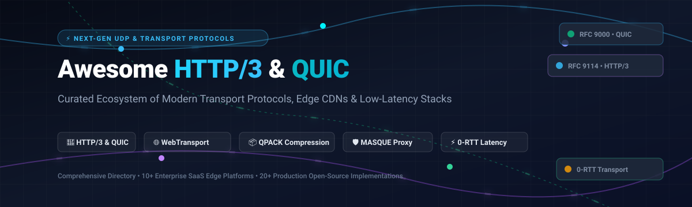

# ⚡ Awesome Network Protocols & HTTP/3 Transport Ecosystem

**Curated directory of enterprise SaaS edge delivery networks, hyperscale cloud CDNs, and battle-tested open-source implementations for next-generation network protocols.**

*Covering IETF QUIC (`RFC 9000`), HTTP/3 (`RFC 9114`), WebTransport, QPACK header compression (`RFC 9204`), MASQUE proxying (`CONNECT-UDP`/`CONNECT-IP`), 0-RTT handshakes, connection migration, and high-performance UDP network engineering.*

📅 **Last updated: November 2026**

---

## 📑 Table of Contents

- [🌐 Sector Overview & Market Dynamics](#-sector-overview--market-dynamics)
- [☁️ Enterprise SaaS & Hosted Edge Delivery Platforms](#️-enterprise-saas--hosted-edge-delivery-platforms)
- [🛠️ Open-Source GitHub Projects](#️-open-source-github-projects)
  - [📦 Core QUIC & HTTP/3 Protocol Libraries](#-core-quic--http3-protocol-libraries)
  - [🚀 Edge Proxies, Web Servers & Load Balancers](#-edge-proxies-web-servers--load-balancers)
  - [🔍 Protocol Tooling, Telemetry & Network Diagnostics](#-protocol-tooling-telemetry--network-diagnostics)
- [🏗️ Architectural Guidelines & Custom Implementations](#️-architectural-guidelines--custom-implementations)
- [🤝 How to Contribute](#-how-to-contribute)
- [⚠️ Security & Operational Disclaimer](#️-security--operational-disclaimer)

---

## 🌐 Sector Overview & Market Dynamics

The global Content Delivery Network (CDN) and next-generation edge transport protocol market is estimated at **$28.5 billion in 2026**, on track to surpass **$100 billion by 2032** at an annual CAGR of 15–17%. This aggressive expansion is driven by universal browser adoption of HTTP/3 (`RFC 9114`), high-fidelity WebTransport interactive video/gaming streaming, API acceleration, and the modernization of cloud-native microservices over multiplexed UDP transports.

The market landscape is **moderately concentrated with a consolidated oligopolistic tier at the top and a specialized long tail**:
* **Top-Tier Concentration:** The leading global providers—dominated by hyperscale cloud platforms (Amazon CloudFront, Google Cloud CDN) and dedicated edge transport pioneers (Cloudflare, Akamai Technologies)—command over **55% of global commercial market revenues**, sustained by multi-terabit anycast backbones and deep ISP peering relationships.
* **Specialized Long-Tail Fragmentation:** A vital and competitive secondary tier thrives around specialized use cases: developer-centric edge programmability (Fastly), zero-trust multi-cloud transit (F5 Distributed Cloud), behavioral DDoS scrubbing (Imperva, Radware), and regional telco-driven content distribution. Parallel to commercial providers, massive private CDNs (Meta, Netflix) deliver significant portions of worldwide streaming payloads over custom QUIC backbones.

---

## ☁️ Enterprise SaaS & Hosted Edge Delivery Platforms

The table below catalogs enterprise SaaS platforms and edge delivery networks providing production-grade HTTP/3, QUIC termination, and high-throughput UDP acceleration. Sorted in descending order by company scale (market capitalization / enterprise valuation):

| 🏢 Platform | 🌐 Primary Focus & Architecture | 💰 Starting Price | 🎁 Free Tier / Trial Limits | 📈 Scale (Valuation / Revenue) |
| :--- | :--- | :--- | :--- | :--- |
| **[Google Cloud CDN & Armor](https://cloud.google.com/cdn)** | Anycast load balancing, global edge caching, and DDoS defense natively terminating HTTP/3 across Google's private backbone. | **$0.02 / GB** (Standard Tier data egress) + $0.0075 / 10k requests | **3-month $300 free trial credit**; 1 TB/month free Cloud Storage egress to Google CDN | **$2,150B Market Cap** (Alphabet) / $350B+ Revenue |
| **[AWS CloudFront](https://aws.amazon.com/cloudfront/)** | Global content delivery network supporting native HTTP/3 over QUIC (`s2n-quic`), TLS 1.3, and CloudFront Functions at the edge. | **$0.085 / GB** (first 10 TB/month after free tier; varies by geography) | **1 TB data transfer out/month**, 10,000,000 HTTP/HTTPS requests/month, 2,000,000 CloudFront Function invocations permanently free | **$2,050B Market Cap** (Amazon) / $600B+ Revenue |
| **[Cloudflare](https://www.cloudflare.com)** | Anycast edge network and WAN routing platform pioneering production HTTP/3, 0-RTT resumption, and MASQUE proxying at internet scale. | **$20 / month** (Pro Plan); $200 / month (Business Plan) | **Free forever plan** with unmetered DDoS mitigation, global CDN caching, and 100,000 Worker requests/day | **$105B Market Cap** / $1.6B+ Revenue |
| **[F5 Distributed Cloud Services](https://www.f5.com/cloud)** | SaaS multi-cloud networking, WAAP, and edge app delivery platform supporting HTTP/3 and TLS 1.3 ingress termination. | **$3.70 / hour** pay-as-you-go marketplace baseline, or $35,000/year annual subscription | **45-day free enterprise trial** with multi-cloud HTTP/3 ingress and WAAP features | **$18.2B Market Cap** / $3.42B Revenue |
| **[Akamai Edge & Prolexic](https://www.akamai.com)** | Enterprise edge delivery and DDoS-mitigated transport platform delivering global HTTP/3, QUIC acceleration, and anycast traffic scrubbing. | **$2,000 / month** minimum enterprise tier commitment (contract-negotiated) | **30-day free trial** with access to edge staging network and HTTP/3 configuration | **$12.8B Market Cap** / $4.3B Revenue |
| **[Lumen Edge & CDN Services](https://www.lumen.com)** | Global Tier-1 fiber backbone and edge delivery network engineered for ultra-high-throughput media streaming and low-latency transit. | **$1,500 / month** base committed port/bandwidth contract tier | **30-day free proof-of-concept (PoC) trial** via enterprise sales engineering | **$4.1B Market Cap** / $12.4B Revenue |
| **[Imperva Cloud WAF](https://www.imperva.com)** | Application security and edge delivery network protecting HTTP/2 and HTTP/3 web endpoints against volumetric and layer-7 DDoS attacks. | **$59 / month** (starter self-serve tier); sales-negotiated WAAP enterprise plans | **30-day full-featured free trial** covering Cloud WAF and DDoS mitigation rules | **$3.6B Valuation** (Thales Acquisition) / $500M Revenue |
| **[Fastly](https://www.fastly.com)** | Programmable edge cloud platform offering low-latency HTTP/3 termination, QUIC connection migration, and real-time Compute@Edge logic. | **$50 / month** pay-as-you-go minimum spend ($0.12/GB bandwidth, $0.0075/10k requests) | **100 GB global bandwidth/month**, 100,000 requests/month, and 5 free TLS domains | **$1.4B Market Cap** / $550M Revenue |
| **[Radware Cloud Protection](https://www.radware.com)** | Cloud network and application security service offering behavioral DDoS mitigation, bot management, and encrypted traffic inspection. | **$1,000 / month** entry cloud marketplace package (10 Mbps protected traffic) | **30-day free trial** for Cloud Application Protection and behavioral WAF | **$1.38B Market Cap** / $302M Revenue |
| **[Edgio / StackPath Infrastructure](https://edg.io)** | Edge compute and content delivery infrastructure designed for real-time video streaming, API acceleration, and modern transport protocols. | **$250 / month** base edge delivery commitment | **14-day free trial** with up to 1 TB evaluation bandwidth | **$200M Enterprise Value** / $380M Revenue |

---

## 🛠️ Open-Source GitHub Projects

This curated registry showcases premier open-source libraries, runtimes, web servers, and diagnostic utilities implementing IETF QUIC (`RFC 9000`), HTTP/3 (`RFC 9114`), and WebTransport. Repositories are organized by category and strictly sorted in **descending order by GitHub stargazers count**.

### 📦 Core QUIC & HTTP/3 Protocol Libraries

Battle-tested network transport protocol libraries implementing packet parsing, connection multiplexing, congestion control (BBR, CUBIC), and frame encryption:

| 🏷️ Repository | 🌟 Stars | 💻 Language | 📖 Description & Capabilities |
| :--- | :---: | :---: | :--- |
| **[cloudflare/quiche](https://github.com/cloudflare/quiche)** |  | Rust / C | Savoury open-source Rust implementation of QUIC and HTTP/3 by Cloudflare; includes C/C++ FFI bindings, QPACK compression, and connection migration support. |
| **[quic-go/quic-go](https://github.com/quic-go/quic-go)** |  | Go | The definitive pure-Go implementation of the QUIC transport protocol and HTTP/3 client/server; powers Caddy, Traefik, and Cloudflared tunnels. |
| **[meta/proxygen](https://github.com/meta/proxygen)** |  | C++ | Meta's high-performance C++ HTTP library and server framework with native HTTP/3 support layered on top of the `mvfst` QUIC transport engine. |
| **[libp2p/go-libp2p](https://github.com/libp2p/go-libp2p)** |  | Go | Modular peer-to-peer networking stack in Go featuring native QUIC transport for encrypted, multiplexed, zero-RTT peer communication. |
| **[libp2p/rust-libp2p](https://github.com/libp2p/rust-libp2p)** |  | Rust | The Rust implementation of the libp2p networking stack featuring asynchronous QUIC and WebTransport protocols for decentralized systems. |
| **[quinn-rs/quinn](https://github.com/quinn-rs/quinn)** |  | Rust | Async-friendly, pure-Rust implementation of the IETF QUIC protocol with an ergonomic Tokio API, custom congestion controllers, and connection pooling. |
| **[microsoft/msquic](https://github.com/microsoft/msquic)** |  | C | Cross-platform C library implementing QUIC; powers Windows HTTP.sys, .NET networking, and SMB-over-QUIC with kernel-bypass (XDP) support. |
| **[mozilla/neqo](https://github.com/mozilla/neqo)** |  | Rust | Mozilla's implementation of QUIC and HTTP/3 written in Rust; powers Firefox's network stack and supports NSS cryptographic backends. |
| **[aiortc/aioquic](https://github.com/aiortc/aioquic)** |  | Python | Complete Python asyncio library for QUIC, HTTP/3, and WebTransport; includes QPACK compression, TLS 1.3 encryption, and built-in test suites. |
| **[litespeedtech/lsquic](https://github.com/litespeedtech/lsquic)** |  | C | High-throughput open-source C library implementing QUIC and HTTP/3; powers LiteSpeed Web Server, OpenLiteSpeed, and HAProxy HTTP/3 modules. |
| **[meta/mvfst](https://github.com/meta/mvfst)** |  | C++ | Meta's production C++ implementation of the IETF QUIC transport protocol; optimizes zero-RTT handshakes and congestion control at Meta scale. |
| **[ngtcp2/ngtcp2](https://github.com/ngtcp2/ngtcp2)** |  | C | Modular, standards-compliant C library implementing IETF QUIC; cryptographic backend agnostic (supports OpenSSL, BoringSSL, Picotls, GnuTLS). |
| **[aws/s2n-quic](https://github.com/aws/s2n-quic)** |  | Rust | AWS's open-source Rust implementation of the IETF QUIC protocol with mathematical formal verification, high-throughput IO backends, and low memory footprint. |
| **[ngtcp2/nghttp3](https://github.com/ngtcp2/nghttp3)** |  | C | Standalone C library implementing HTTP/3 framing and QPACK encoding/decoding without being tied to any specific QUIC implementation. |
| **[google/quiche](https://github.com/google/quiche)** |  | C++ | Google's cross-platform transport collection containing production C++ QUIC, HTTP/3, and BBR congestion control code extracted from Chromium. |
| **[hyperium/h3](https://github.com/hyperium/h3)** |  | Rust | Asynchronous HTTP/3 implementation in Rust built atop Tokio and abstract QUIC transport backends (including `quinn`). |
| **[private-octopus/picoquic](https://github.com/private-octopus/picoquic)** |  | C | Minimalist C implementation of QUIC, HTTP/3, and MASQUE (`CONNECT-UDP`) authored by IETF co-editor Christian Huitema. |
| **[BiagioFesta/wtransport](https://github.com/BiagioFesta/wtransport)** |  | Rust | Async WebTransport library in Rust over HTTP/3; provides bidirectional streaming and unreliable datagram transport for modern browsers and backends. |
| **[quic-go/webtransport-go](https://github.com/quic-go/webtransport-go)** |  | Go | WebTransport protocol implementation in Go built on `quic-go`, allowing browser WebTransport clients to exchange streams and datagrams. |

---

### 🚀 Edge Proxies, Web Servers & Load Balancers

High-performance reverse proxies, web servers, and client utilities terminating production QUIC and HTTP/3:

| 🏷️ Server / Proxy | 🌟 Stars | 💻 Language | 📖 Architecture & HTTP/3 Integration |
| :--- | :---: | :---: | :--- |
| **[caddyserver/caddy](https://github.com/caddyserver/caddy)** |  | Go | Modern enterprise web server with automatic TLS certificate provisioning and out-of-the-box HTTP/3 termination powered by `quic-go`. |
| **[curl/curl](https://github.com/curl/curl)** |  | C | The world's primary CLI data transfer utility and library supporting HTTP/3 requests via `ngtcp2`, `quiche`, and `msquic` backends. |
| **[nginx/nginx](https://github.com/nginx/nginx)** |  | C | High-concurrency reverse proxy featuring native `ngx_http_v3_module` for QUIC transport and HTTP/3 downstream listener support. |
| **[envoyproxy/envoy](https://github.com/envoyproxy/envoy)** |  | C++ | Cloud-native edge and service proxy featuring production-grade QUIC downstream and upstream transport via Google's `quiche` library. |
| **[hyperium/hyper](https://github.com/hyperium/hyper)** |  | Rust | Fast and correct HTTP implementation in Rust, serving as the foundational building block for Rust HTTP client/server ecosystems and HTTP/3 adapters. |
| **[haproxy/haproxy](https://github.com/haproxy/haproxy)** |  | C | Ultra-fast TCP/HTTP load balancer and reverse proxy supporting native QUIC (`RFC 9000`) listener frontends and connection multiplexing. |
| **[apache/trafficserver](https://github.com/apache/trafficserver)** |  | C++ | Industrial forward and reverse caching proxy supporting production HTTP/3 using modular `quiche` and `ngtcp2` network drivers. |

---

### 🔍 Protocol Tooling, Telemetry & Network Diagnostics

Diagnostic, inspection, and visualization utilities for debugging QUIC streams, encrypted handshakes, and transport performance:

| 🏷️ Diagnostic Tool | 🌟 Stars | 💻 Ecosystem | 📖 Core Diagnostic Capability |
| :--- | :---: | :---: | :--- |
| **[wireshark/wireshark](https://github.com/wireshark/wireshark)** |  | C / C++ | Industry-standard packet analyzer featuring full QUIC, HTTP/3, and QPACK dissectors with TLS `SSLKEYLOGFILE` decryption. |
| **[quiclog/qvis](https://github.com/quiclog/qvis)** |  | TypeScript | Interactive browser visualization tool for QUIC and HTTP/3 event traces; visualizes packet drops, congestion windows, and multiplexing flows. |
| **[quiclog/qlog](https://github.com/quiclog/qlog)** |  | Schemas / Tooling | Standardized structured logging format specification and tools for QUIC, HTTP/3, and WebTransport network traces. |

---

## 🏗️ Architectural Guidelines & Custom Implementations

When engineering custom low-latency systems combining HTTP/3, QUIC, and WebTransport, adhere to these proven design patterns:

* **🛠️ Recommended Technology Stacks:**
  * **Rust Ecosystem:** Combine `cloudflare/quiche` or `quinn` + `h3` with Tokio for microsecond-grade proxying and custom protocol implementations.
  * **Go Ecosystem:** Combine `quic-go` with `webtransport-go` or Caddy modules for rapid server development, real-time gaming backends, and microservices.
  * **C/C++ Ecosystem:** Pair `ngtcp2` + `nghttp3` or `msquic` with epoll/kqueue event loops for embedded devices and extreme packet-throughput applications.
* **⚡ 0-RTT Security Guardrails:** Never permit non-idempotent HTTP methods (`POST`, `PUT`, `DELETE`) over 0-RTT early data. Restrict 0-RTT handshakes strictly to safe idempotent reads (`GET`, `HEAD`) to eliminate transaction replay vulnerability risks.
* **🛡️ UDP & MTU Discovery:** Configure Path MTU Discovery (PMTUD) and ensure servers respond with ICMP Fragmentation Needed / Packet Too Big messages. Standardize base UDP payload datagrams at 1200 bytes to ensure transit across restrictive WAN tunnels without fragmentation.
* **🔄 Alt-Svc Negotiation:** Always advertise HTTP/3 availability over HTTP/2 using the `Alt-Svc: h3=":443"; ma=86400` HTTP header, ensuring reliable fallback to TCP/TLS when client enterprise firewalls block UDP port 443.

---

## 🤝 How to Contribute

We welcome additions, benchmarks, and updates to both SaaS products and open-source protocol implementations:

1. 🍴 **Fork** this repository.
2. 🌿 **Create a branch**: `git checkout -b feature/new-protocol-tool`.
3. ✏️ **Edit `README.md`**: Follow existing table schema, ensure star badges link to stargazers, verify pricing/free-tier specifics, and keep company valuations updated.
4. 🚀 **Commit & Push**: `git commit -m "Add new HTTP/3 implementation" && git push origin feature/new-protocol-tool`.
5. 📬 **Submit a Pull Request** with a concise description of why the tool belongs in this awesome list.

⭐ **Star the repo** if you find it helpful for your network protocol and systems engineering work!

---

## ⚠️ Security & Operational Disclaimer

* This repository is a **community-curated index** published strictly for educational and architectural reference purposes; listings do not represent commercial endorsements.
* HTTP/3 and QUIC operate over UDP (`port 443`). Legacy corporate firewalls and middleboxes occasionally drop or throttle UDP packets. Always design dual-stack architectures with graceful HTTP/2 (TCP) fallback mechanisms.
* Always validate address validation tokens (`Retry` packets) and implement stateless connection reset mechanisms to guard against UDP reflection and volumetric amplification attacks.

---

**Crafted with ⚡ for network protocol engineers, systems programmers, CDN architects, and low-latency systems builders.**

[Back to Top ↑](#-awesome-network-protocols-http3-transport-ecosystem)

